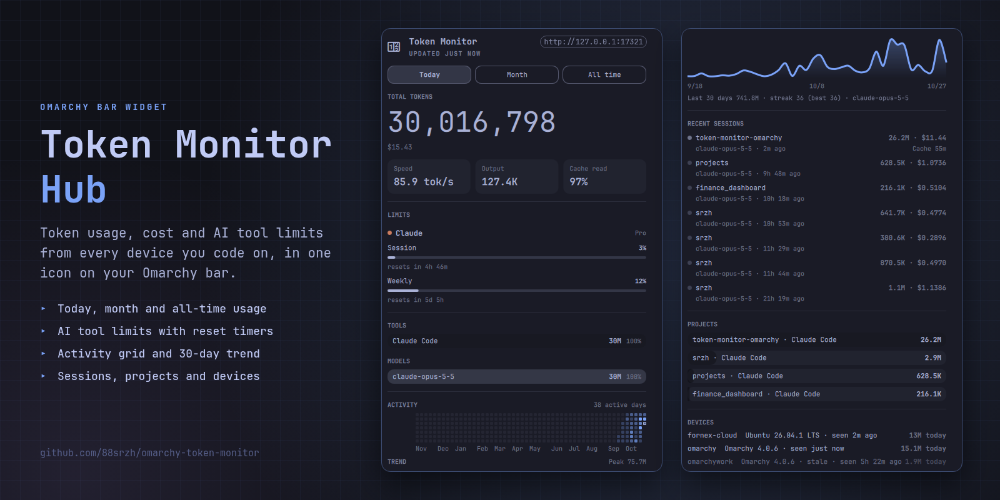

# Token Monitor Hub for Omarchy

An [Omarchy](https://omarchy.org) 4 bar widget for the [Token Monitor](https://github.com/Javis603/token-monitor) hub: token usage, cost and AI tool limits for your AI coding tools, across all your devices. One icon in the bar, which takes Omarchy's alarm colour when a quota passes 90%, and a panel with today / month / all-time totals, limits, tool, model and project breakdowns, a rolling-year activity grid and trend line, recent sessions and devices.



This is an unofficial widget, built on [Javis603/token-monitor](https://github.com/Javis603/token-monitor). It is published from the [token-monitor-omarchy](https://github.com/88srzh/token-monitor-omarchy) fork; report issues there.

## External dependencies

The widget only draws. The data comes from a Token Monitor backend that runs on your machine, from the [token-monitor-omarchy](https://github.com/88srzh/token-monitor-omarchy) checkout:

- a hub on `127.0.0.1:17321` and a headless agent that collects your usage, installed as systemd user services (`token-monitor-hub`, `token-monitor-agent`). The hub requires a random secret the installer generates into an owner-only `.env`, so other users of the machine cannot read or change its records;
- a Node.js bridge the widget starts, which follows the hub and hands the panel ready-made rows;
- Node.js 22.15 or newer (`mise use -g node@lts`) and git.

The agent's first start downloads the pinned tokscale binary it reads usage with, from the [Javis603/tokscale](https://github.com/Javis603/tokscale) releases, and checks its hash. Nothing needs root.

## Install

The installer sets up the backend and adds this widget:

```bash
git clone https://github.com/88srzh/token-monitor-omarchy.git ~/.local/share/token-monitor
~/.local/share/token-monitor/scripts/omarchy/install.sh
```

If you added the widget first with `omarchy plugin add https://github.com/88srzh/omarchy-token-monitor.git`, run the same two commands: the installer keeps the widget where it is and points it at the backend. Until then the icon is dimmed and the panel says "backend not installed".

The installer writes these, and nothing else:

| What | Where |
|---|---|
| Runtime dependencies, if missing | `npm ci --omit=dev` in the checkout |
| A random hub secret and a loopback host, if not set, in an owner-only file | `.env` in the checkout (`TOKEN_MONITOR_SECRET`, `TOKEN_MONITOR_HOST=127.0.0.1`, mode 600) |
| The hub's data directory closed to other users | `data/` in the checkout (mode 700) |
| Hub and agent user services, enabled and started | `~/.config/systemd/user/token-monitor-{hub,agent}.service` |
| Where the widget finds the checkout and Node | `~/.config/token-monitor-omarchy/backend.json` |
| This widget, through `omarchy plugin add`, placed in the bar's right section on first install | `~/.config/omarchy/plugins/io.github.88srzh.token-monitor/`, `~/.config/omarchy/shell.json` |

## Update

```bash
cd ~/.local/share/token-monitor
git pull
scripts/omarchy/install.sh
```

The installer updates the widget too (`omarchy plugin update`) and restarts `omarchy-shell` when the widget changed. If you update with `omarchy plugin update` alone, run `omarchy-restart-shell` afterwards: the shell reloads a changed plugin but keeps showing the previous panel until it restarts.

## Remove

```bash
~/.local/share/token-monitor/scripts/omarchy/install.sh --uninstall
rm -rf ~/.local/share/token-monitor
```

The first command removes the widget, the services and `backend.json`; the second deletes the checkout with your collected usage history. To remove only the widget, use `omarchy plugin remove io.github.88srzh.token-monitor`.

## Use

- Left click opens the panel; right click reconnects to the hub.
- In the panel: `h` / `l` or `1` / `2` / `3` switch period, `j` / `k` scroll, `r` reconnects, Esc closes.
- `omarchy-shell token-monitor <open|close|toggle|refresh>` for key bindings.
- `omarchy bar set io.github.88srzh.token-monitor period month` opens the panel on another period (`today`, `month`, `allTime`).

Configuration (a hub on another machine, a shared secret, other devices) is described in [docs/omarchy.md](https://github.com/88srzh/token-monitor-omarchy/blob/main/docs/omarchy.md).

## License

MIT, see [LICENSE](LICENSE). It keeps the copyright notice of the original Token Monitor.
